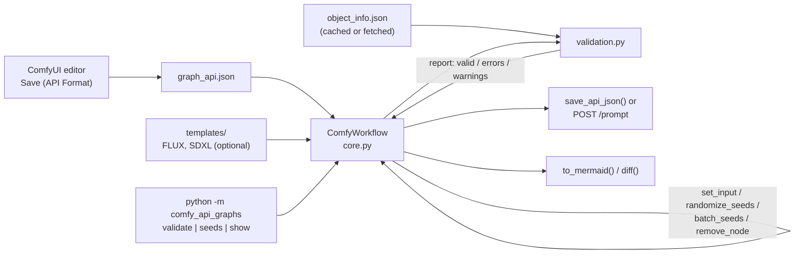
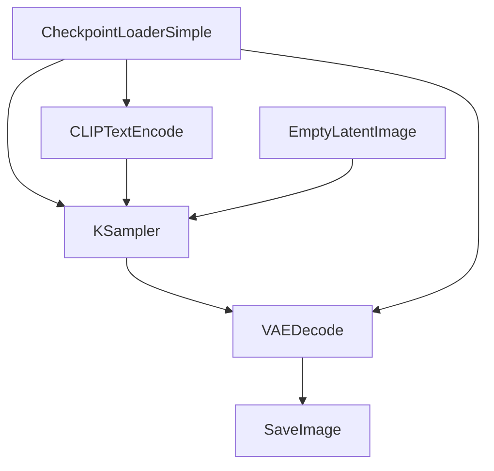

Offline Python helper to load, mutate and validate ComfyUI API-format graphs, with no runtime dependencies.

# Comfy API Graphs

[](https://www.python.org/downloads/)
[](https://opensource.org/licenses/MIT)

Zero-dependency Python helper for ComfyUI **API-format** JSON by **[ U N B R A N D E D ]**.

**Product:** load a Save (API Format) export → mutate prompt/seed/ckpt → validate → re-queue.
Not a runtime, not ComfyScript, not a UI↔API converter, not private worker stacks.

```python
from comfy_api_graphs import ComfyWorkflow, validate_against_object_info, load_object_info

# 1. Design in ComfyUI UI → Dev Mode → Save (API Format)
wf = ComfyWorkflow.from_api_json("my_graph_api.json")

# 2. Mutate without reopening the node editor
wf.set_input_by_class_type("CLIPTextEncode", "text", "a new prompt")
wf.randomize_seeds()

# 3. Fail before the queue (optional: cached /object_info snapshot)
report = validate_against_object_info(wf, load_object_info("object_info.json"))
assert report["valid"], report["errors"]

# 4. Re-export or POST {"prompt": wf.to_api_format()} to /prompt
wf.save_api_json("my_graph_api.seeded.json")
```

## Why this exists

ComfyUI's node editor is the right place to *design* a graph, but the exported **API-format** JSON is what automation actually touches: batch runs, seed sweeps, prompt swaps, CI checks. Editing that JSON by hand is error-prone, and a bad link or a missing required input only shows up after you have queued a job and burned GPU time.

This package is the small, boring layer in between: load the export, change specific inputs, check the graph **offline** (links, and optionally the schema from a cached `/object_info`), then write it back or POST it. It is intentionally not a runtime, not a UI-to-API converter and has zero runtime dependencies. See [docs/maintainers/SYNC_POLICY.md](docs/maintainers/SYNC_POLICY.md) for the scope boundary.

## Architecture



| Path | Role |
|------|------|
| `src/comfy_api_graphs/core.py` | `ComfyWorkflow`: load, mutate, introspect, diff, Mermaid, seed batches |
| `src/comfy_api_graphs/validation.py` | Link checks, `/object_info` schema checks, orphan and duplicate-seed detection, VRAM hint |
| `src/comfy_api_graphs/templates/` | Optional generic FLUX/SDXL/utility wiring templates |
| `src/comfy_api_graphs/__main__.py` | Stdlib CLI |
| `examples/`, `tests/` | Runnable examples; 142 tests plus fixtures |

## Show, don't tell

Real output from the CLI on `tests/fixtures/minimal_api_graph.json` (a 6-node text-to-image graph):

| Command | What you get |
|---------|--------------|
| `python -m comfy_api_graphs show graph.json --mermaid` | A Mermaid flowchart that renders inline on GitHub (below) |
| `python -m comfy_api_graphs validate graph.json --object-info object_info.json` | `Link check: OK` and `valid: True`, exit code 0; non-zero on errors |
| `python -m comfy_api_graphs seeds graph.json --bump 100 --count 3 --out-dir out/` | Three files `*_seed_000..002.json` with seeds 100, 101, 102 |



No screenshots or GIFs are shipped: the library has no UI.

## Verified quickstart

Checked on 2026-10-12 with Python 3 in a fresh virtualenv:

```bash
git clone https://github.com/U-N-B-R-A-N-D-E-D/comfy-api-graphs.git
cd comfy-api-graphs
python -m venv .venv && source .venv/bin/activate
pip install -e ".[dev]"
pytest                      # 142 passed
ruff check src tests && black --check src tests && mypy src   # all clean
python -m comfy_api_graphs validate tests/fixtures/minimal_api_graph.json \
  --object-info tests/fixtures/minimal_object_info.json         # valid: True
```

Results: 142 tests pass (coverage about 94%), lint, format and type checks are clean, and the three CLI commands above run as described. Not verified in this pass: queueing against a live ComfyUI server (`POST /prompt`, `fetch_object_info`), since no server was available.

## Limitations

- Alpha (0.4.x): the public API may change between minor versions; see [CHANGELOG.md](CHANGELOG.md).
- API-format only. It does not convert editor-format ("UI") graphs, and `to_graph_format` is a deprecated skeleton that will not round-trip into the editor.
- Validation is only as good as the `/object_info` snapshot you give it; link checks alone do not prove a graph will run.
- `estimate_vram_usage` is a planning hint, not a predictor.
- FLUX/SDXL templates are generic teaching wiring, and the LTX/Wan video templates are stubs that raise `NotImplementedError`.
- Not published on PyPI; install from GitHub or a clone.

## Scope

Public core for ComfyUI **API-format graphs**: nodes, loaders, LoRAs, `/object_info`, `/prompt`, seed batch. Generic FLUX/SDXL templates teach wiring — they are optional, not the main path. Design in the UI → Save (API Format) remains king.

## Features

- **Load and mutate**: `from_api_json` / mutators / seed helpers for Save (API Format) exports
- **Seed batch cookbook**: dry-run write or live `/prompt` loop (`examples/seed_batch_cookbook.py`)
- **Batch seed generator**: `ComfyWorkflow.batch_seeds(n, mode, start)` yields N distinct copies
- **Schema validation**: `validate_against_object_info` + `load_object_info` / `fetch_object_info`
  (with link-vs-scalar type sanity and orphan-node warnings)
- **Duplicate-seed detection**: `find_duplicate_seeds_across_batch` catches cache-skip collisions before queue
- **Link checks**: `validate_node_references` (existence only — use object_info for schemas)
- **Graph introspection**: `iter_links`, `remove_node`, `topological_order` (cycle detection)
- **Graph diff & viz**: `diff(other)` structured diff; `to_mermaid()` for inline GitHub PR/issue rendering
- **Stdlib CLI**: `python -m comfy_api_graphs validate|seeds|show` — no GPU, no runtime deps
- **Optional templates**: FLUX.1 / SDXL T2I / I2I / inpaint / upscale / outpaint / character refs
- **Honest VRAM hint**: `estimate_vram_usage` returns a planning hint with an explicit disclaimer — not a predictor
- **Zero runtime dependencies**: Pure Python core (stdlib `urllib` for optional fetch)

## Installation

**Not on PyPI yet.** Install from GitHub or a local clone:

```bash
# From GitHub (front door until a real PyPI release exists)
pip install "git+https://github.com/U-N-B-R-A-N-D-E-D/comfy-api-graphs.git"

# Or from a local clone
pip install -e .
pip install -e ".[dev]"        # pytest, etc.
pip install -e ".[examples]"   # optional example extras (requests, websockets)
```

`make publish` / `make publish-test` refuse silent uploads until packaging credentials are configured on purpose.

## Quick Start

### Primary: load → mutate → re-queue

```python
from comfy_api_graphs import ComfyWorkflow

wf = ComfyWorkflow.from_api_json("my_graph_api.json")
wf.set_input_by_class_type("CLIPTextEncode", "text", "a futuristic cityscape")
wf.set_input_by_class_type("KSampler", "steps", 24)
wf.bump_seeds(1)  # or wf.randomize_seeds()
wf.save_api_json("my_graph_api.seeded.json")
```

Or run `examples/seed_batch_cookbook.py` for a dry-run / live queue loop.

### Validate against `/object_info` before burning GPU

```python
from comfy_api_graphs import (
    ComfyWorkflow,
    fetch_object_info,
    load_object_info,
    validate_against_object_info,
)

wf = ComfyWorkflow.from_api_json("my_graph_api.json")

# Live (localhost ComfyUI) — or load a CI snapshot:
info = fetch_object_info()  # http://127.0.0.1:8188/object_info
# info = load_object_info("fixtures/object_info_snapshot.json")

report = validate_against_object_info(wf, info)
if not report["valid"]:
    raise SystemExit(report["errors"])
```

### CLI (no GPU, fits in a CI step)

```bash
# Validate links + optional object_info schema
python -m comfy_api_graphs validate my_graph_api.json --object-info object_info.json

# Mutate seeds and write N copies
python -m comfy_api_graphs seeds my_graph_api.json --bump 100 --count 5 --out-dir out/

# Render a Mermaid flowchart (paste into a PR/issue — renders inline on GitHub)
python -m comfy_api_graphs show my_graph_api.json --mermaid
```

### Optional: template (secondary)

```python
from comfy_api_graphs import FluxTxt2ImgTemplate

workflow = FluxTxt2ImgTemplate.create(
    prompt="a futuristic cityscape with flying cars",
    width=1024,
    height=768,
    steps=20,
    seed=42,
)
workflow.save_api_json("my_workflow.json")
```

### Custom graph from scratch

```python
from comfy_api_graphs import ComfyWorkflow, validate_node_references

wf = ComfyWorkflow("custom_pipeline")
loader = wf.add_node(
    "CheckpointLoaderSimple",
    {"ckpt_name": "sd_xl_base_1.0.safetensors"},
    title="Load Checkpoint",
)
positive = wf.add_node(
    "CLIPTextEncode",
    {"text": "beautiful landscape", "clip": loader.get_output_ref(1)},
)
errors = validate_node_references(wf)
```

## Available templates (optional)

| Template | Purpose | Notes |
|----------|---------|--------|
| `FluxTxt2ImgTemplate` | FLUX.1 T2I | DualCLIP + UNET + VAE + ModelSamplingFlux + KSampler |
| `FluxImg2ImgTemplate` | FLUX.1 I2I | LoadImage → VAEEncode → denoise |
| `FluxInpaintTemplate` | FLUX.1 inpaint | ImageToMask + SetLatentNoiseMask |
| `SdxlTxt2ImgTemplate` | SDXL T2I | Optional refiner second pass |
| `SdxlImg2ImgTemplate` | SDXL I2I | Checkpoint + denoise |
| `UpscaleTemplate` | Upscale | UpscaleModelLoader or LatentUpscaleBy |
| `InpaintTemplate` | SDXL-class inpaint | SetLatentNoiseMask |
| `OutpaintTemplate` | Outpaint | ImagePadForOutpaint + mask |
| `CharacterReferenceTemplate` | Multi-angle refs | SDXL T2I prompt batch |

**Not shipped as working recipes:** LTX / Wan video templates. Stubs under `templates/video_templates.py` raise `NotImplementedError`.

## How a community user should use these

1. Install ComfyUI and place matching model files.
2. `pip install "git+https://github.com/U-N-B-R-A-N-D-E-D/comfy-api-graphs.git"` (or `pip install -e .` from a clone).
3. Design the graph in the UI → Save (API Format).
4. Load / mutate / validate with this library; queue with `POST /prompt` and `{"prompt": workflow.to_api_format()}`.
5. Prefer `validate_against_object_info` over link-only checks before long jobs.

## API sketch

### `ComfyWorkflow`

```python
wf = ComfyWorkflow.from_api_json("workflow_api.json")
wf.set_input("4", "seed", 123)
wf.randomize_seeds()
api_format = wf.to_api_format()
wf.save_api_json("workflow_api.seeded.json")

# Graph introspection / mutation
list(wf.iter_links())              # [(src_id, slot, dst_id, dst_input), ...]
wf.remove_node("6")                # drop a node + clean dangling links
wf.topological_order()             # execution order (raises on cycles)
wf.to_mermaid()                    # Mermaid flowchart for PR/issue diffs
wf.diff(other_wf)                  # structured added/removed/changed diff
list(wf.batch_seeds(5, mode="bump", start=100))  # 5 distinct-seed copies
```

### Validation

```python
validate_node_references(wf)                     # links exist?
validate_against_object_info(wf, info)           # class_types + required inputs
                                                 #   + link/scalar type sanity
                                                 #   + orphan-node warnings
find_orphan_nodes(wf)                            # dead computations (no consumer)
find_duplicate_seeds_across_batch([wf_a, wf_b])  # cache-skip collision check
validate_workflow_complete(wf)                   # links + SaveImage/loader heuristics
estimate_vram_usage(wf)                          # planning hint only (see disclaimer)
```

### Deprecated: `to_graph_format` / `save_graph_json`

These emit a **skeleton** with empty `links` — they do **not** round-trip into the ComfyUI frontend. Calling them raises `DeprecationWarning`. Use `to_api_format` / `save_api_json`. Design editable graphs in the UI.

## Examples

- `seed_batch_cookbook.py` — **start here**: load API JSON → mutate seeds → write or `/prompt`
- `validate_before_queue.py` — link + object_info schema check before burning GPU
- `diff_workflows.py` — structured diff + Mermaid between two Save (API Format) graphs
- `execution_example.py` — queue on local ComfyUI
- `basic_txt2img.py` — optional FLUX T2I template
- `img2img_with_lora.py` — optional FLUX I2I + LoRA
- `custom_workflow.py` — low-level `ComfyWorkflow` build
- `utility_templates_example.py` — upscale / inpaint / outpaint / character refs
- `video_generation.py` — shows quarantined stubs raise `NotImplementedError`

## Creating custom templates

```python
from comfy_api_graphs import ComfyWorkflow

class MyCustomTemplate:
    @staticmethod
    def create(prompt: str, width: int = 1024, height: int = 1024) -> ComfyWorkflow:
        wf = ComfyWorkflow("my_custom_workflow")
        # add CheckpointLoaderSimple / CLIPTextEncode / KSampler / SaveImage ...
        return wf
```

Prefer real ComfyUI `class_type` names from `/object_info`. Do not invent speculative custom nodes.

## Contributing

See [CONTRIBUTING.md](CONTRIBUTING.md) and [AGENTS.md](AGENTS.md). Run `make lint` and `make test` before opening a PR; use `docs/`, `feat/` or `fix/` branches.

## Citation

Cite via [CITATION.cff](CITATION.cff) (GitHub's "Cite this repository" button). Release history: [CHANGELOG.md](CHANGELOG.md).

## License

MIT License — Copyright (c) 2026 [ U N B R A N D E D ]. See [LICENSE](LICENSE).

## Acknowledgments

Thanks to the ComfyUI team and the wider custom-node community. FLUX.1 is by Black Forest Labs; SDXL is by Stability AI — templates here only teach common ComfyUI wiring patterns around those models.
